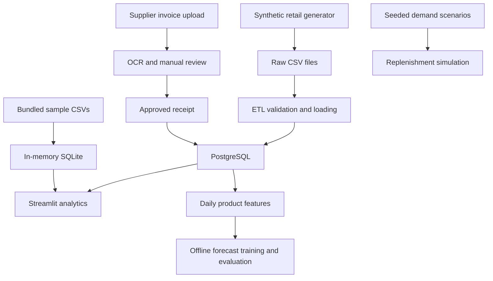

# Smart Inventory and Demand Prediction Practical Exam Study Guide

Smart Inventory and Demand Prediction is a Python project for a simulated electronics retailer. It answers three practical questions: **What sold? What stock is available? What should we prepare to reorder?** It combines a Streamlit dashboard, a synthetic retail data pipeline, a supplier invoice scanner, and offline forecasting and replenishment experiments.

**One-minute viva answer**

> My project is an inventory decision-support system for an electronics retailer. I generate reproducible sales and inventory data, validate it, and load it into PostgreSQL. A Streamlit dashboard shows sales, stockouts, lost sales, and the latest stock per product. The invoice scanner extracts supplier invoice lines and lets a shopkeeper check the product and quantity before approving a stock receipt in PostgreSQL. A separate machine-learning pipeline uses historical features to estimate daily units sold, and a simulation studies how replenishment rules affect stock availability. For the practical demonstration I can run the dashboard and invoice preview with built-in sample data.

## Architecture and data flow



**Analytics** uses existing records to explain past performance and latest stock. **Forecasting** estimates daily sales from historical features. **Inventory simulation** applies stocking policies to demand scenarios and measures the outcomes. The experiment runner generates its own demand series. The dashboard does not call the forecast-training or simulation workflows during navigation.

## Technology stack

| Technology | Role in this checkout |
| --- | --- |
| Python 3.13 and Streamlit | Application logic, scripts, charts, tables, filters, and browser-based UI |
| PostgreSQL, SQL, and Psycopg 3 | Live tables, queries, foreign keys, transactions, and invoice stock updates |
| SQLite from the Python standard library | In-memory data source for local demo analytics |
| pandas, NumPy, CSV, JSON, and Parquet | Data preparation, numerical calculations, datasets, results, and metadata |
| scikit-learn and joblib | Model preprocessing, regression, comparison, and saving the selected model |
| Pillow and pypdfium2 | Image and PDF handling |
| Windows Media OCR via winocr, Tesseract via pytesseract, and optional PaddleOCR-VL | Text recognition and, depending on the engine, layout extraction |
| PyYAML and python-dotenv | Simulation configuration and environment settings for database connections |
| pytest and Git | Automated checks and version control |

The running interface is Streamlit and queries the data layer through Python. React, FastAPI, and an Ollama assistant appear in the original architecture plan. The current browser app does not require them. The implemented forecast models are from scikit-learn, and the optional vision-language OCR worker serves document extraction.

## What the application does

| Page | What you can show |
| --- | --- |
| Dashboard / Overview | Units sold, products, current inventory, lost sales, stockout product-days, average daily units sold, and demand versus observed sales |
| Sales Analytics | Daily sales, biggest selling products for the selected dates, and unit sales growth versus an equally long preceding period |
| Product Analytics | Filter by category and compare products by units sold, stockout days, and lost units |
| Inventory Analytics | Latest recorded stock per product, days since last record, inventory freshness, and historical stock movements, lost sales, and stockouts |
| Invoice Scanner | Upload a document or use the camera, preview it, run available OCR, inspect recognized lines, and edit extracted items. PostgreSQL mode adds catalog reconciliation, draft/approval/rejection, and invoice history. |

The sidebar dates constrain historical queries that take a date range. Product Analytics has its own category filter. The current stock view uses the latest inventory entry for each product, regardless of the selected historical date range. Supplier, promotion, and customer analyses exist in the SQL and query layer.

## Data generation and database design

The Python generator uses `config/simulation_spec.yaml` and a random seed to reproduce a retail history. It creates a product catalog and suppliers, customers, promotions, sales, daily inventory snapshots, and purchase orders. The simulated sales depend on demand and available inventory. The generator can record true demand directly because it creates the scenario. In a real store, unmet demand usually has to be estimated.

The base PostgreSQL schema has eight tables. `categories`, `suppliers`, `products`, `customers`, and `promotions` describe business entities. `sales` records customer transactions. `purchase_orders` records replenishment orders and expected and actual deliveries. `inventory` records the daily stock movement and demand for a product. Each product/date pair has at most one inventory row. The invoice migration adds `products.stock_unit`, `purchase_invoices`, and `purchase_invoice_items`. One invoice header can have multiple line items. A purchase order is a request to buy stock, while a supplier invoice is a document used here to review and post an incoming receipt.

ETL means **extract, transform, load**. It reads incoming CSVs, normalizes values such as dates, validates required fields, checks duplicate keys and inventory business rules, separates rejected records, and writes accepted data to PostgreSQL. The pipeline supports full, incremental, and dry-run modes. A dry run exercises processing without writing to the database. Idempotent loading means rerunning a load does not create extra copies of the same record.

### Inventory arithmetic

- **Closing stock** = opening stock + units received − observed units sold.
- **Lost sales units** = true demand − observed units sold in the synthetic generator.
- **Stockout product-days** count product/date pairs with a stockout flag. Two products stocking out on the same date contribute two product-days.
- **Example**. Open with 20 units and receive 10. Demand is 35 units. The store sells 30 units, loses 5 potential sales, and closes with zero stock.

## Invoice scanning and approval

1. Choose a document type and upload an invoice or capture a photo. Files can be PDF, TIFF, JPG/JPEG, or PNG, up to 25 MB. The validator checks the file and reports page information.
2. Run an available OCR engine. OCR identifies text. The parser uses the recognized text or layout to identify invoice details, product lines, quantities, and units. Review uncertain lines and fix errors before moving on.
3. In PostgreSQL mode, match each extracted product against the catalog and verify its stock unit. For example, 2 cartons with 12 pieces per carton become 24 pieces after confirming the conversion factor. For stale inventory, a last record more than 30 days old triggers physical-stock confirmation during approval.
4. Check for duplicates, then save the draft or approve. SHA-256 detects identical document bytes. Supplier and invoice reference can flag a possible re-scan even when the file hash differs.
5. On approval, PostgreSQL locks the records being changed and posts received quantities as a transaction. Multiple receipts on the same day accumulate in units received and closing stock while preserving the day's original opening stock. The application stores invoice headers and items and manages pending, approved, and rejected documents in `data/invoices/`. A failed approval rolls back its database changes.

## Feature engineering and demand forecasting

**Prediction target.** The training target `demand_units` is daily **observed units sold** per product. Transactions are aggregated to one row per product per day, and dates without sales are included in the continuous grid. The saved 2025 feature dataset has 20 products, 365 days, 7,300 rows, and 48 columns. This is the historical training dataset. The SQLite dashboard demo uses a separate short sample.

**Predictors.** The feature stage builds calendar fields, sales lags of 1, 7, 14, and 28 days, rolling statistics over 7, 14, and 28 days, product/category attributes, historical inventory, and promotion fields. A 7-day lag for a target date is that product's sales seven days earlier. Rolling calculations start from shifted history. Inventory predictors use prior-day information, so the model cannot see the same day's closing stock when predicting sales for that day.

**Stockout censoring.** When products run out, recorded sales can understate customer demand. The forecast loader attaches the stockout flag for the target product and date as an evaluation mask. The pipeline reports overall and uncensored errors, and selects the model by validation MAE on uncensored rows.

**Training and testing.** The code compares yesterday's value, the same weekday last week, 7-day and 28-day moving averages, Ridge regression, Random Forest, and Histogram Gradient Boosting. It uses expanding-window cross-validation inside the training period. The validation winner is refitted on training plus validation data and evaluated on a held-out later period.

| 2025 period | Role |
| --- | --- |
| Jan 29–Sep 30 | Training after the initial 28 days needed for history |
| Oct 1–Nov 15 | Validation and model selection |
| Nov 16–Dec 31 | Held-out test |

**Saved result.** Histogram Gradient Boosting was selected in the saved run. On 914 uncensored test rows it had **MAE 1.93 units**, **RMSE 2.81 units**, and **WAPE 8.92%**. The 28-day moving average had an MAE of **2.40 units** on those rows. MAE is the average absolute error in units. RMSE gives larger errors more weight. WAPE is total absolute error divided by total actual units. These results describe the held-out portion of the synthetic dataset and do not establish performance on a real store. See `data/processed/stage11/model_comparison_summary.csv` and `stage11_metadata.json` in the same folder.

## Replenishment and simulation

**Lead time** is how long an order takes to arrive. **Safety stock** is a buffer for demand or delivery uncertainty. **Inventory position** includes on-hand stock plus units already on order, minus outstanding backorders.

- Reorder point = expected demand during lead time + safety stock.
- Target stock = reorder point + expected demand during the review period.
- Order-up-to quantity = max(0, target stock − inventory position).

**Worked example.** Suppose the next three days each require 8 units and lead time is three days. With 5 units of safety stock, the reorder point is 29. Adding 4 units for the review period gives a target of 33. If you have 18 units on hand, 6 on order, and 2 backordered, inventory position is 22. The calculated replenishment quantity is 11 units.

The offline experiment models daily receipts, demand fulfillment, and replenishment. It reviews the order-up-to quantity after each day. The experiment configuration compares nine scenarios with different lead times, safety stock, and review-period settings over 30 seeded replications of 180 days. Each replication reuses its demand series across scenarios so the policies face the same demand. The engine supports backorders and lost-sales behavior, and the bundled scenarios use backorders. Results include stockout days, units backordered, average on-hand stock, service level, reorder frequency, and turnover. A backorder is unmet demand carried forward. A lost sale is unmet demand that disappears.

## Practical demonstration

**Start the app.** In PowerShell, from the project directory with dependencies installed in `.venv`, run the following and open [the dashboard](http://localhost:8501).

```powershell
$env:INVENTORY_DEMO = "1"
.\.venv\Scripts\python.exe -m streamlit run frontend/app.py
```

1. Start on **Overview**. Explain units sold, lost sales, and stockout product-days. Change the date window and point to a historical KPI that changes.
2. Open **Sales Analytics** and show the daily trend. Then open **Product Analytics** and use the category filter.
3. Open **Inventory Analytics**. Choose a product and explain its latest recorded stock, date, and reconciliation status.
4. Open **Invoice Scanner**. Use a clean sample invoice. Preview it, run an available OCR engine, and point out a recognized product and quantity. Explain where the shopkeeper would verify the unit and approve the receipt with PostgreSQL.
5. Open the saved `model_comparison_summary.csv`. Show the selected model and baseline MAE. Work through the replenishment example if the examiner asks how a forecast can support a stock decision.

**Live database demonstration.** Configure and seed PostgreSQL using `docs/database/database-setup.md`, apply the invoice migration, and start without the demo setting. A successful approval can then be demonstrated by comparing a product's stock before and after posting. PostgreSQL was unreachable during local verification, so use the SQLite demo for the dashboard walkthrough unless the live database is ready. The 124 passing targeted checks covered the dashboard, OCR and parsing, data checks, simulation, and offline model logic. Live PostgreSQL integration remains unverified in this environment.

## Viva questions and answers

1. **What problem does the project solve?** It helps a retailer see stockouts, understand what sold, and plan replenishment before products run out.
2. **Why synthetic data?** It is reproducible and lets us compare true demand, sales, and stockouts under controlled scenarios.
3. **What is the difference between sales and true demand?** Sales count units actually purchased. True demand includes units customers wanted but could not buy.
4. **Why are CSV validation and database constraints both useful?** Validation catches bad input and explains rejected rows. Database constraints enforce relationships and uniqueness during writes.
5. **What is the key of a daily inventory record?** The schema has an `inventory_id` primary key and a separate uniqueness constraint on product and date.
6. **What is an UPSERT?** It inserts a row if the key is new and updates the matching row if the key already exists.
7. **How does the system prevent a duplicate invoice?** It checks the document hash and warns about similar supplier/reference matches. PostgreSQL enforces uniqueness of approved document hashes.
8. **Why require human review after OCR?** OCR may misread digits, units, or similar product names. Approving those errors would update the wrong stock.
9. **Why lock rows during approval?** Concurrent updates to the same product must combine both receipts without one update overwriting the other.
10. **What is feature leakage?** Using information unavailable at prediction time, such as target-day closing stock. The pipeline uses earlier sales and prior inventory snapshots as inputs.
11. **Why split training and test data chronologically?** The model must learn from earlier observations and be evaluated on later observations as it would be in forecasting.
12. **Why compare with a moving average?** A simple baseline gives a meaningful reference for whether a more complex model improves predictions.
13. **What does an MAE of 1.93 mean?** In the saved uncensored test sample, the absolute error averaged about 1.93 units per product-day.
14. **What is the difference between reorder point and target stock?** The reorder point represents lead-time demand plus a buffer. Target stock can also include expected demand over the review period.
15. **What happens if PostgreSQL is unavailable?** Demo mode gets its analytics from bundled SQLite data and can still preview OCR. Invoice posting and history need PostgreSQL.
16. **What would improve this project?** Test against real retail data, improve estimation of demand during stockouts, and connect recurring forecast and replenishment outputs to the dashboard.

## Source code to revise

| Topic | Where to look |
| --- | --- |
| Running the app | `README.md` and `docs/database/database-setup.md` |
| Dashboard and SQL queries | `frontend/app.py` and `frontend/data/dashboard_queries.py` |
| Data generation and ETL | `data_generator/simulation.py`, `config/simulation_spec.yaml`, and `etl/pipeline.py` |
| Tables and constraints | `database/schema/schema.sql` and `database/migrations/stage9_invoice_tables.sql` |
| OCR, matching, and approval | `frontend/utils/ocr_service.py`, `invoice_parser.py`, `product_matcher.py`, and `invoice_db.py` in the same folder |
| Forecasting | `ml/features/feature_pipeline.py`, `ml/forecasting/forecast_pipeline.py`, and `data/processed/stage11/` |
| Replenishment experiments | `ml/inventory_decision/simulation/core.py`, `engine.py`, `sensitivity.yaml`, and `output/experiment_records.csv` under the simulation folder |
