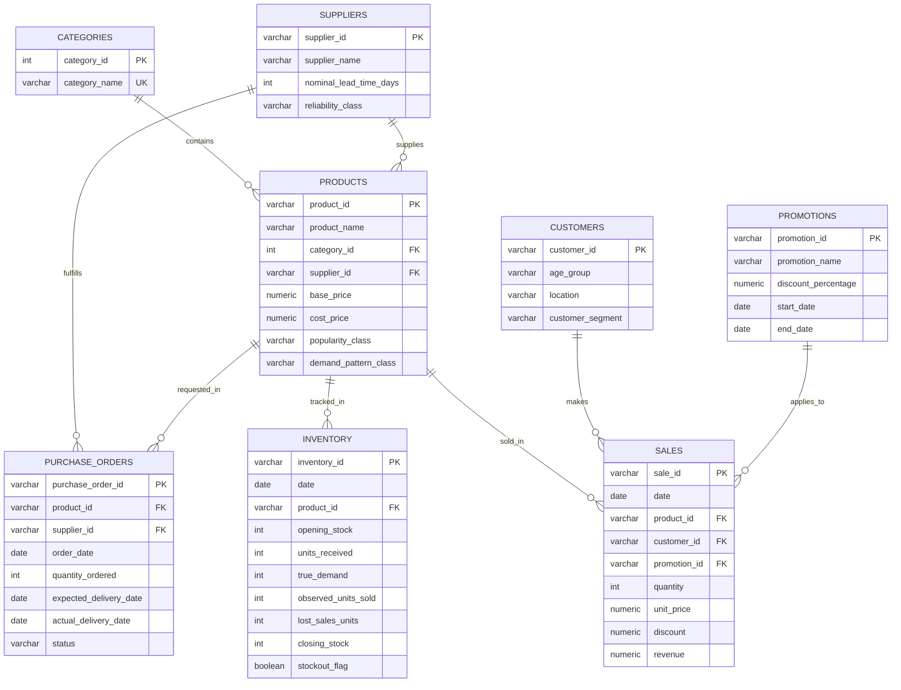

# PostgreSQL Database Design
## Smart Inventory & Demand Prediction System

This document outlines the final relational schema for the Stage 3 database `smart_inventory`, reflecting the structure of the synthetic raw data generated in Stage 2.

## Entity Relationship Diagram

## Schema Details
The full schema can be found in `database/schema/schema.sql`.

Key considerations implemented:
- **Foreign Keys**: Strong relational enforcement ensures no orphan transactions.
- **Constraints**: 
  - Stock levels (opening, closing, true demand, sales) must be `>= 0`.
  - Financials (revenue, prices) must be `>= 0`.
  - Discounts are constrained between `0` and `1`.
  - Delivery dates and end dates strictly follow start dates.
- **Primary Keys**: We utilized the natural `id` attributes created by the Stage 2 generator (e.g. `sale_id`, `inventory_id`). A composite unique constraint was added to `inventory (date, product_id)`.
- **Data Types**: All prices are represented precisely as `NUMERIC(10,2)` or `NUMERIC(12,2)` rather than approximate floats.

## Mappings
The explicit translation of CSV columns to PostgreSQL columns, including surrogate additions like `category_id`, is defined in [csv-to-postgres-mapping.md](csv-to-postgres-mapping.md).

## Loading Order
To satisfy constraints, data is loaded in the following dependency order:
1. `categories`
2. `suppliers`
3. `products`
4. `customers`
5. `promotions`
6. `purchase_orders`
7. `inventory`
8. `sales`
